# Aster · 星枢

面向 Komari 的服务器监控与资产管理主题，由 shaolonger 独立维护。提供节点总览、VPS 工作台、多目标 Ping 分析、节点比较与可离线保存的全面报告。

## 安装与迁移

- 主题仓库：<https://github.com/shaolonger/Komari-Theme-Aster>
- 在 [Releases](https://github.com/shaolonger/Komari-Theme-Aster/releases/latest) 下载 `Komari-Theme-Aster-v*.zip`，通过 Komari 后台上传并启用。
- 从旧主题迁移时，先记录原主题配置，再添加新仓库或上传 Aster 包；后端可能按主题名称分别存储配置，启用后请检查并恢复设置。
- Aster 延续仓库已有的语义化版本序列。工作台展开偏好使用 Aster 独立存储。

## 后端兼容性

主题会自动识别官方 Komari 与既有二次修改版的 RPC 能力，并将两者归一化为同一套页面数据模型。有关适配范围、迁移注意事项、指标与 Ping 的处理方式，以及完整的验证命令，请见 [兼容性说明](COMPATIBILITY.md)。

后台主题菜单可直达 Aster 工作室；Komari 官方文档注明 `redirect` 配置入口需要服务端高于 1.2.0。较旧版本仍可从首页右上角打开工作室。

## 网络观测

Aster 1.12.0 将配置统一到 **工作室 → 网络观测**：主页延迟、主页三网线路、检测方案、探测器与测量点、目标端点各自独立。首页 / 实例页快捷入口带上 VPS 范围，实例页专注当前节点报告与立即检测。旧工具诊断、旧单次报告、旧计划和迁移功能已删除。

网络观测提供原生 TCP 质量、泰尔公共测速适配、定时与历史趋势；另可显式启用完整 TcpQuality 检测，运行上游脚本并保存报告。线路按 ASN、登记地址段和商业声明区分，补充 CTGNet 和 CN2 证据；全部外观共用等高三网单元格，可点击查看同轮观测。见[网络观测指南](network-observatory/README.md)及[计量说明](docs/network-native-measurements.md)。

1.13.1 修复路由元数据缺失：无 ASN 时仍保留位置、WHOIS 和域名；网络与位置同时显示，支持查看独立 NextTrace 路径、来源及失败诊断。需要新采集信息的 VPS 更新探测器至 1.9.1 后重新检测，已有凭证和旧报告继续可用。

1.13.2 增加 Alpine / OpenRC 探测器支持，修复必须使用 systemctl 的安装限制。小内存或小剩余空间自动选择轻量安装，可显式传入 `--profile lite`；保留基础延迟与 MTR 路由，跳过大型可选工具，限制采样并发。详见[安装说明](network-observatory/README.md#安装与升级)。

1.14.0 统一探测器面板的字号与分区，安装 / 升级命令始终可见，重置凭证单独确认。新增保留凭证的事务升级和默认关闭的可选自动更新，等待空闲、验证新心跳、失败回滚；三网卡片区分同路径多网与不同测量组合，不按“最佳线路”隐藏实测信息。详见[维护说明](network-observatory/README.md)。

1.14.1 修复面板插件频繁解析 / 重写全部队列、空闲轮询扫描全部节点和重复维护造成的 CPU 开销。仅需覆盖更新面板插件 **1.11.1**；已有 VPS 探测器和凭证可继续使用。附[服务端 CPU 排查步骤](docs/network-observatory-cpu.md)。

1.15.0 在卡片新增「三网测速」：最近一轮大陆测速的 P1 上下行、城市切换、实际地址族及测试时间。需更新主题和插件；已有探测器无需重装。在工作室 → 网络观测 →「主页三网测速」管理显示和访客发布范围。

1.15.1 为三网测速增加 IPv4 / IPv6 独立切换和历史恢复，为三网线路增加测试时间，并精简卡片中的发布 / 管理提示。需同时更新主题和插件，探测器及凭证保持可用。

1.16.0 默认将三网线路精简为一个优选观测网络，隐藏线路确认与测速计量副文案。工作室 → 网络观测中的线路、测速面板可独立恢复完整网络组合和说明，IPv4 / IPv6 与测试时间继续保留。详见[卡片展示策略](docs/network-card-presentation.md)。

1.17.0 针对 52 节点的小时负载重构保留期巡检、计划派发和队列持久化，减少历史全量扫描及每条任务重写整份队列；探测器同步优化测速采样和结果重试。已有凭证、检测计划和报告保留，详见[CPU 原因、基准与升级核验](docs/network-observatory-cpu.md)。

1.17.1 改进小规格 LXC 的安装启动：在创建子进程前读取进程 / 线程配额，名额不足时明确报告 cgroup 及实际数值；减少早期身份和内存检查的子进程。修复安装器的诊断与开销，不会绕过宿主机配额。探测器仍为 1.11.0，已安装正常的节点无需升级，见 [LXC 排障](network-observatory/README.md#lxc-安装时出现-cant-fork)。

1.18.0 改进泰尔公共测速的超时与恢复：分阶段计时、目录短缓存、严格匹配候选与零数据失败方向补测。全局排队增加冷却；旧探测器的目录超时可有限退避，已成功方向和流量预算保留。完整改进需要插件 1.15.0 与探测器 1.12.0，使用保留凭证升级命令。详见[可靠性与诊断](docs/network-native-measurements.md#公共测速可靠性与诊断1180)。

1.19.0 将三网线路、三网测速压缩为紧凑表格，保留独立双栈、城市、方向与时间。管理员可在卡片一键执行对应方案，查看真实排队 / 检测进度；完成后刷新并高亮结果，部分与失败独立标记。合并页面进度查询，检测结束停止轮询。需要主题 1.19.0 / 插件 1.16.0，探测器仍为 1.12.0；详见[卡片快捷检测](docs/network-card-quick-check.md)。

1.20.0 为 VPS 全面报告增加全部可读取历史、网络观测趋势和过期后的逐目标摘要；修复缺口旁孤立数据点不可见及旧后端结果截断的问题。详见[全面报告指南](docs/vps-report-guide.md)。

1.20.1 修复顶部今日流量在部分 VPS 覆盖不足时只显示“部分数据”的问题：显示排行中可计算值的合计，覆盖不完整时标记近似并说明节点数。午夜整点样本正确识别为周期边界。

1.21.1 新增完整 TcpQuality 检测方案，可按间隔或每天多个时刻执行，在 VPS 详情中查看各轮报告、测量覆盖和 CSV。先升级插件，再按[完整检测说明](network-observatory/README.md#完整-tcpquality-检测)为需要的 VPS 显式启用特权执行器；请留意执行时间、挂载权限和可用空间。

1.21.2 在 VPS 详情页内直接预览完整 TcpQuality 在线报告，可使用上游报告的分类切换；预览受限时可打开原报告。

## 效果预览

以下图片由当前仓库代码在官方 Komari 兼容模拟环境中直接运行并截图，展示 Aster 当前界面；演示节点和监控数值均为模拟数据。

  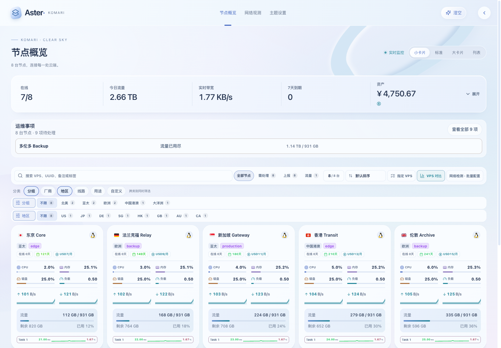

### 首页总览

首页聚合在线率、流量、带宽、风险、到期和资产数据，并支持搜索、组合筛选、排序、节点选择及多种卡片密度。

  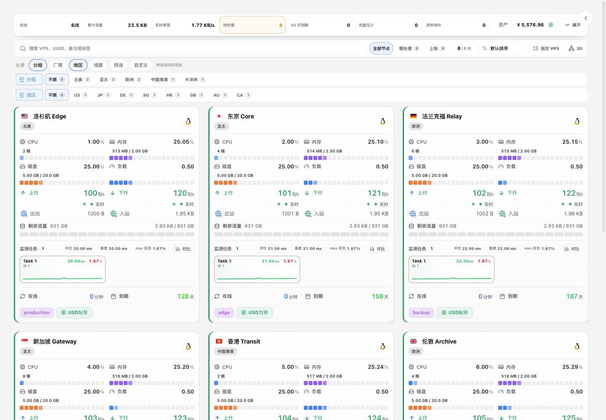

  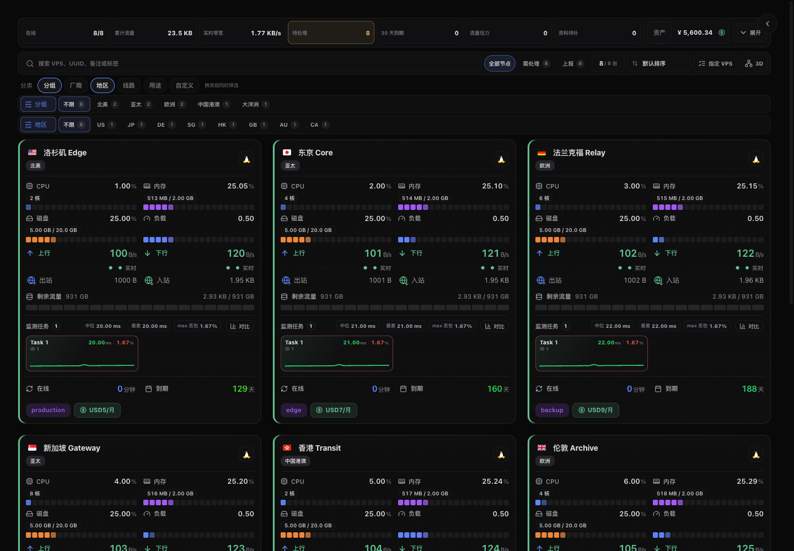

### 曜石外观与三网线路

v1.11.1 新增「曜石」石墨灰和对应的「曜石·明」亮色外观，按参考图呈现四宫格资源、分段指标、逐任务延迟 / 丢包趋势及 IPv4 / IPv6 三网去程和回程。三网线路同步支持全部既有外观；使用真实路径 ASN，需要网络观测插件 **1.9.1**；管理员直接预览，访客需选择发布节点。缺测、未识别、部分路径和过期结果明确区分。详见[使用与配置指南](docs/obsidian.md)。

  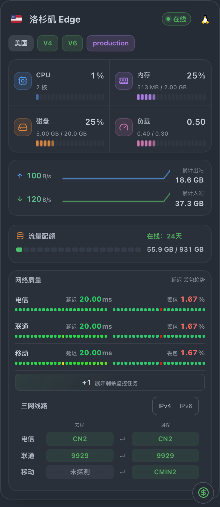
  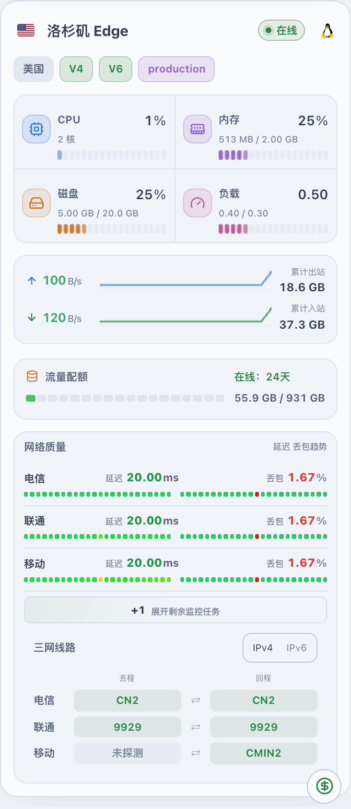

### 澄空外观

v1.10.0 新增「澄空」：冷白冰蓝、薄片叠层卡片和轻微空间视差。首页右上角展开快捷按钮后选择「澄空」，或在 Aster 工作室将其保存为默认外观。小卡片同时显示已用 / 总流量、剩余额度、占比及进度；不限量和超额情况会明确区分。触屏与系统「减少动态效果」自动停用立体动效。详见[使用说明与实际截图](docs/clear-sky.md)。

  

  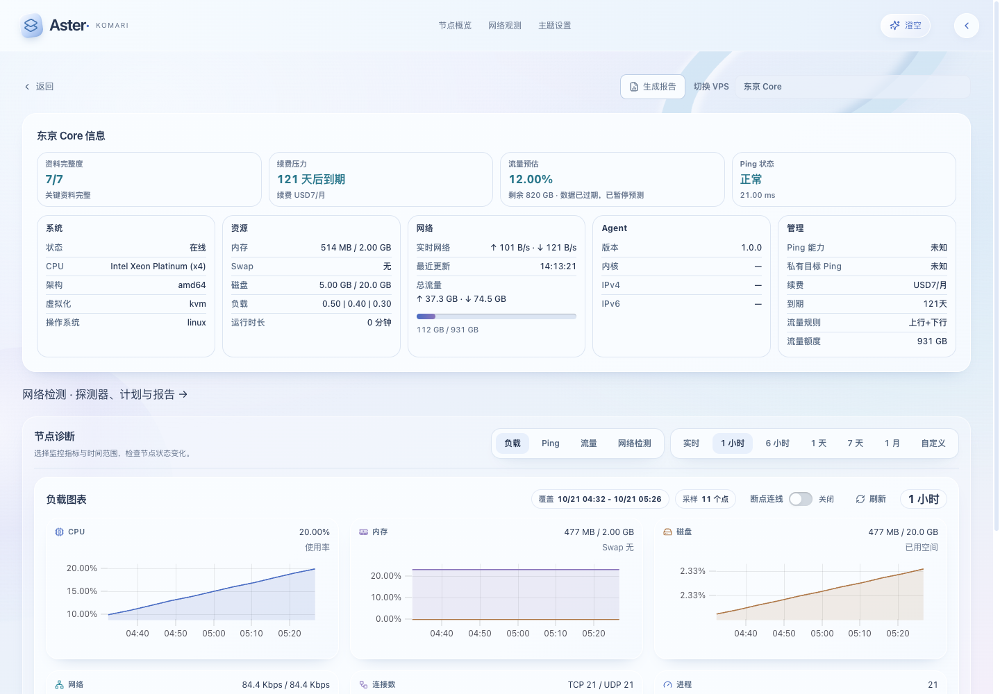

### 实例详情

实例详情集中展示资料完整度、续费压力、流量预估、运行状态，以及可切换时间范围的负载和多任务 Ping 图表。

  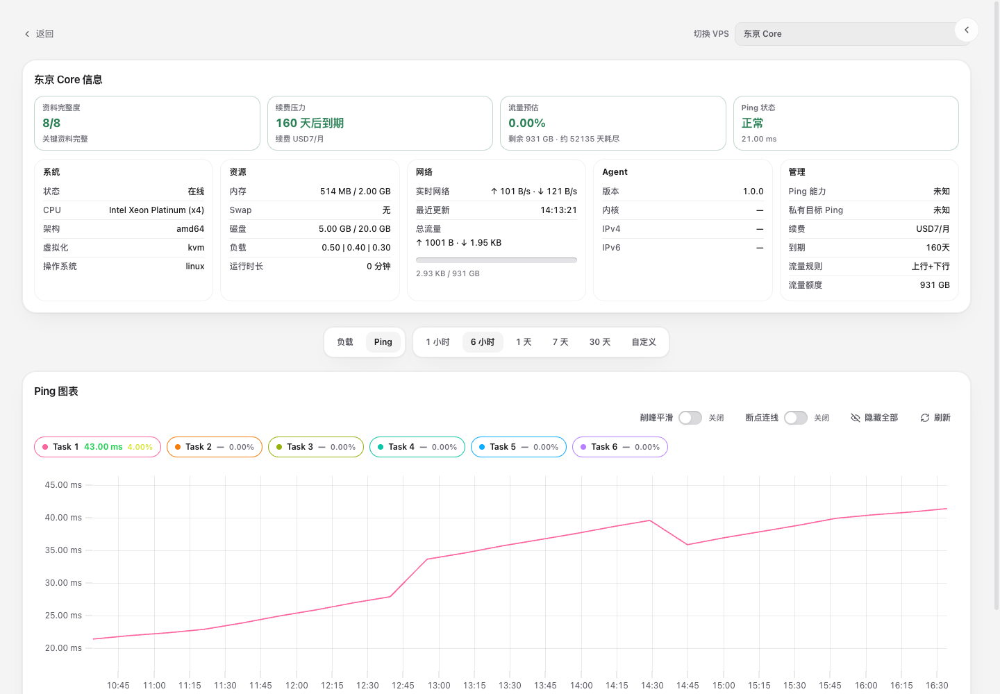

### VPS 全面报告

在详情页选择日期，一键汇总性能资源、Ping 与既有网络检测、带宽流量、配置资产及事件线索。报告明确标注缺测和统计精度，可按原格式下载自包含 HTML，断网后仍能查看全部章节、图表和明细；另提供 JSON 与 PDF 打印。使用方式与数据限制见[全面报告指南](docs/vps-report-guide.md)。

  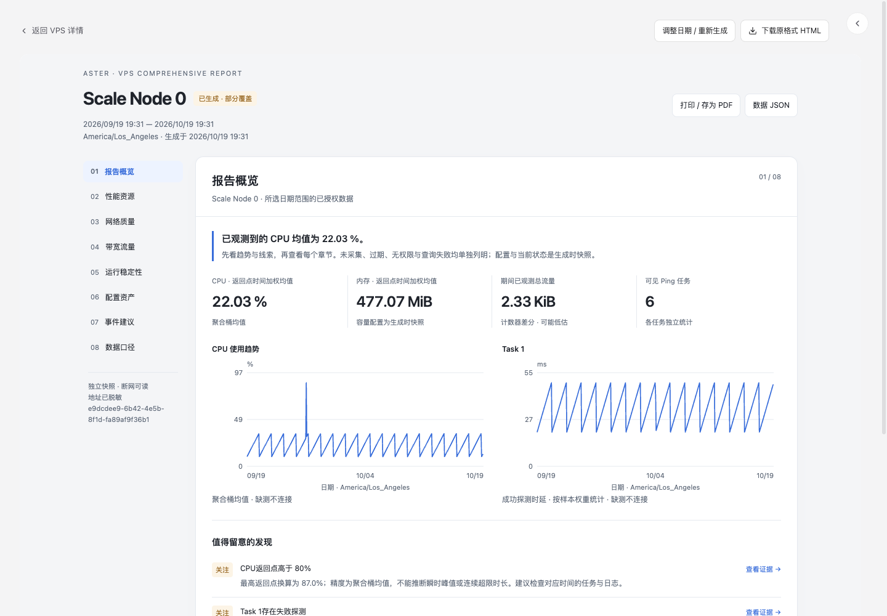

### VPS 对比工作台

可同时选择多台 VPS 和多项指标，对齐时间序列并查看趋势、排名、统计摘要与 Ping 任务范围。

  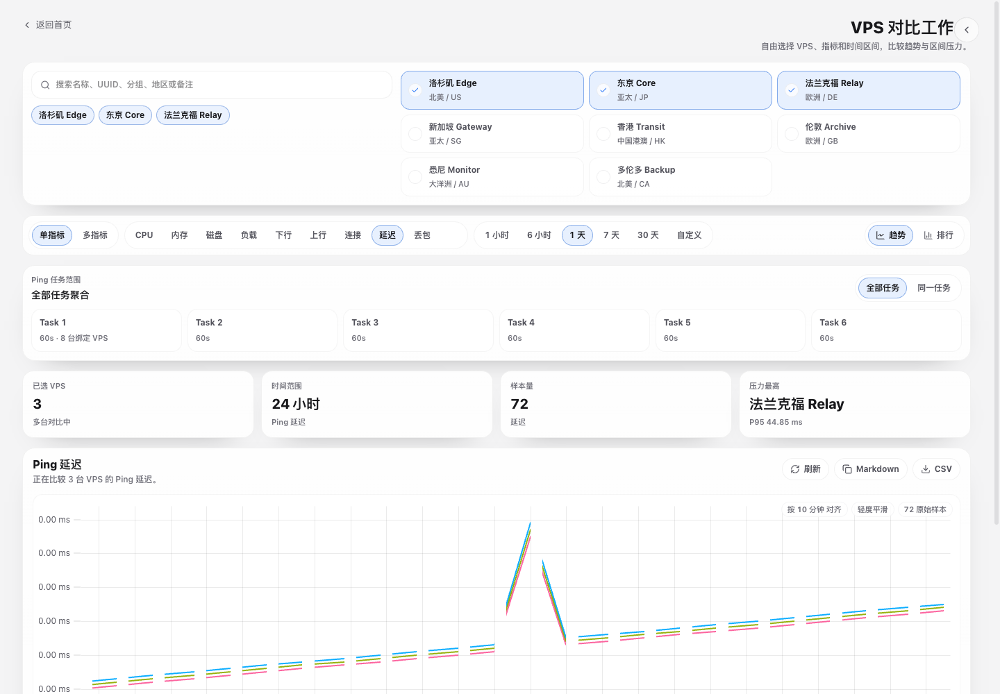

### 资产统计

资产面板按月均价格、剩余价值和到期时间汇总节点成本，支持排序和汇率换算。

  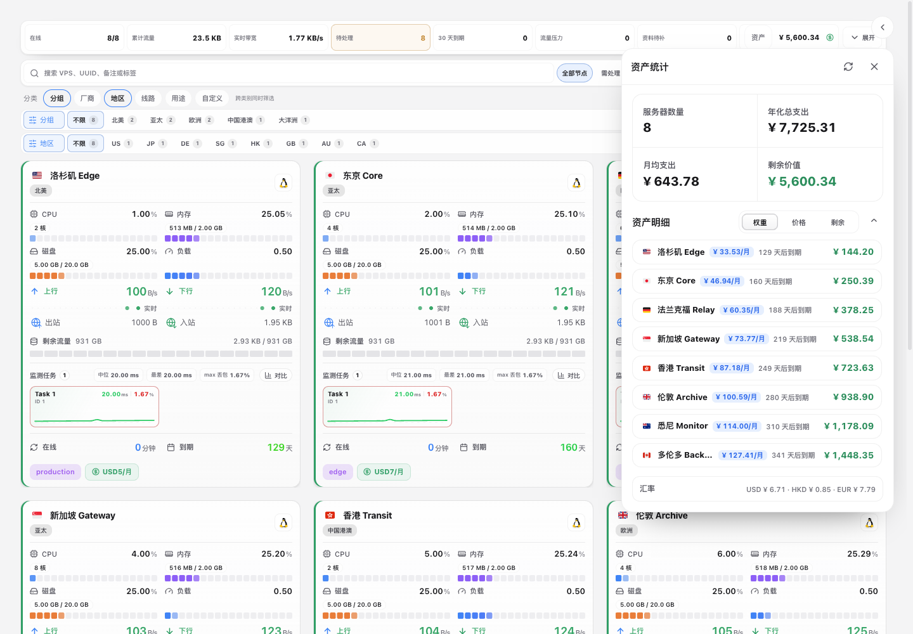

### Aster 工作室

Aster 工作室按外观、巡检、节点、资产和网络组织配置，支持分区搜索、草稿撤销、节点选择和批量任务绑定。保存失败时保留草稿。

  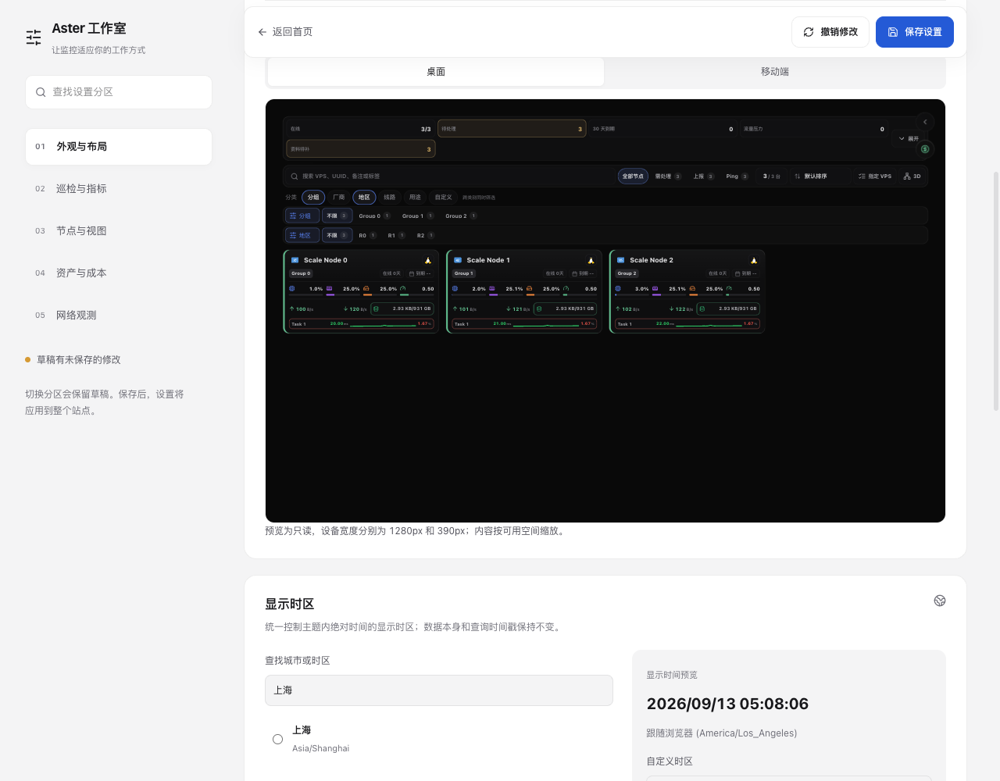

### 移动端

移动端采用紧凑卡片和折叠总览，在窄屏中保留筛选、资产、实时指标及 Ping 趋势。

  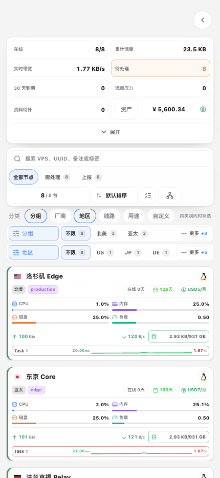
  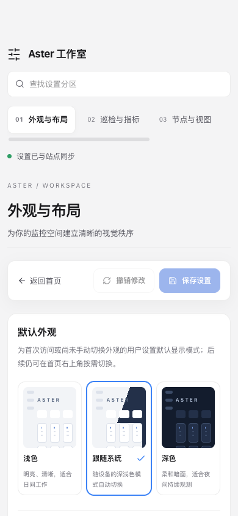

## 来源与致谢

本项目最初基于 [shanyang242/Komari-Theme-LuminaPlus](https://github.com/shanyang242/Komari-Theme-LuminaPlus) 修改，现以 Aster 品牌持续开发。感谢 shark、shanyang 及原项目贡献者的工作；更名保留原有贡献历史与来源说明。

特别感谢 [stqfdyr/komari-theme-Lumina](https://github.com/stqfdyr/komari-theme-Lumina)。

也感谢 Komari 官方主题、Mochi、PurCarte 等主题项目为 Komari 生态提供的设计和实现思路。

## 参考

- [Komari](https://github.com/komari-monitor/komari)
- [komari-theme-Lumina](https://github.com/stqfdyr/komari-theme-Lumina)
- [Komari 主题开发文档](https://komari-document.pages.dev/)

## Star History

<a href="https://www.star-history.com/?repos=shaolonger%2FKomari-Theme-Aster&type=timeline&legend=bottom-right">
 <picture>
   <source media="(prefers-color-scheme: dark)" srcset="https://api.star-history.com/chart?repos=shaolonger/Komari-Theme-Aster&type=timeline&theme=dark&legend=bottom-right" />
   <source media="(prefers-color-scheme: light)" srcset="https://api.star-history.com/chart?repos=shaolonger/Komari-Theme-Aster&type=timeline&legend=bottom-right" />
   
 </picture>
</a>

Aster v1.8.0 的新版网络报告支持完整 MTR、HTTP/iperf3 单连接双向、AWS/网站/CDN/Telegram 矩阵及 BGP/RPKI。请同步升级插件至 1.9.1、runner 至 1.8.0；使用步骤见[新版指南](docs/network-report-v3-guide.md)。
