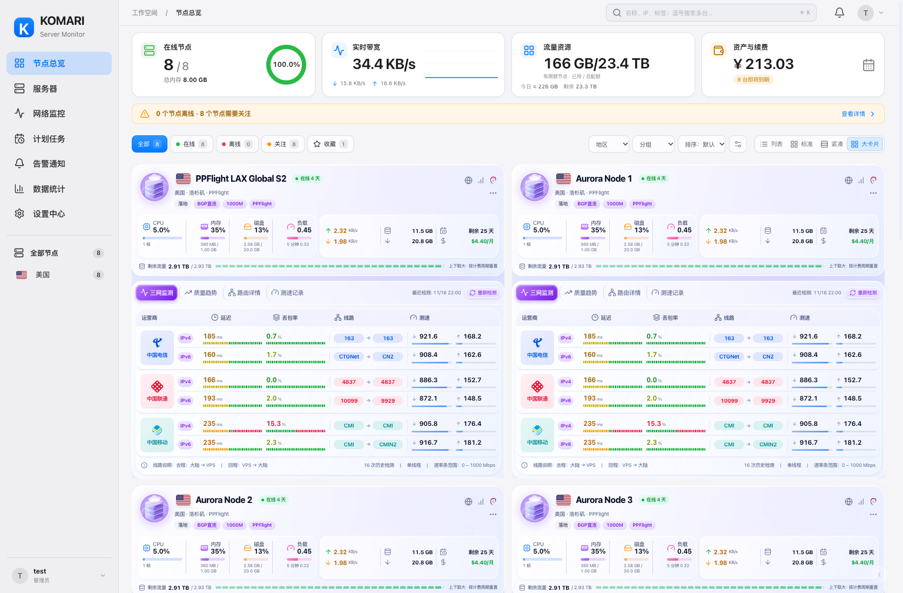
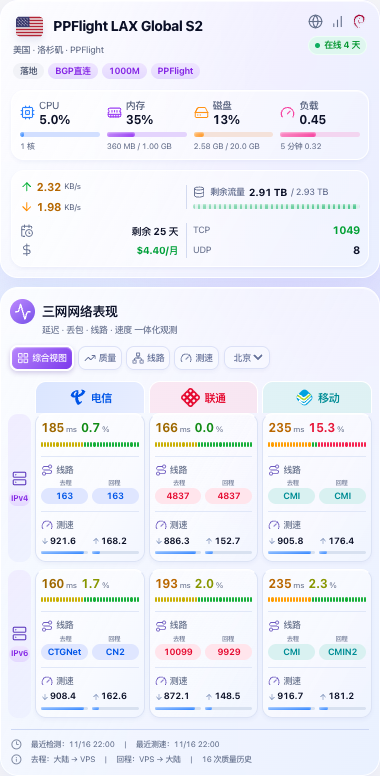
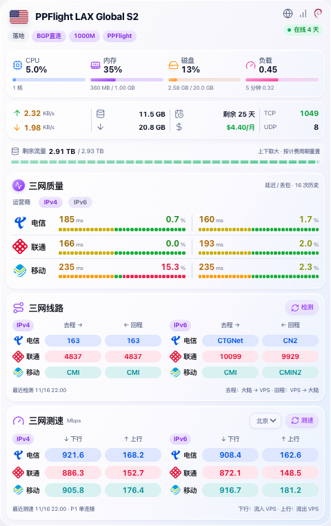
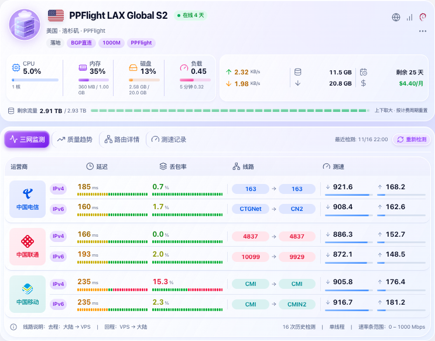

# 极光玻璃 · Aurora

在首页快捷菜单的外观选项中选择「极光玻璃」，或在「Aster 工作室 → 外观与布局」将它设为站点默认外观。紧凑、标准、大卡片分别采用独立布局；列表继续使用现有列表功能。

## 页面框架

卡片以外的区域直接复用「原生 · Cupertino」：侧栏与地区导航、顶部搜索与账户菜单、在线节点 / 实时带宽 / 流量资源 / 资产与续费四项汇总、关注提示、状态筛选、地区与分组筛选、排序、视图切换、移动导航，以及实例详情、图表和设置页面。四项汇总直接置于页面顶部，省去重复的大标题与说明。页面采用 Cupertino 的浅灰背景、白色面板和系统蓝，玻璃渐变限于节点卡片区域。



[查看复用 Cupertino 的实例详情页](images/aurora/instance.png)。

浏览器检查会将侧栏、顶部导航、搜索、汇总及筛选栏与 Cupertino 对照，验证共享样式一致，同时检查标题区移除后的空间回收。

## 卡片尺寸与布局

三种模式均为多列网格，少量节点和单条搜索结果保持独立卡片宽度。紧凑卡片以 300px 为建议最小宽度、最大 380px；标准以 360px 为建议最小宽度、最大 480px；大卡片以 560px 为建议最小宽度、最大 840px。窄屏可进一步缩小并自动转为单列。

在 1672px 桌面视口及原生侧栏下，八节点示例分别排为紧凑四列、标准三列、大卡片两列。字号、内边距、资源条及三网内容采用对应的卡片密度。

## 三种布局

紧凑模式将实时资源与网络表现分为两张玻璃卡片，三家运营商横排、IPv4 / IPv6 纵排，单元格包含质量、线路和测速。综合 / 质量 / 线路 / 测速按钮切换展示内容。



[查看紧凑模式整页截图](images/aurora/home-compact.png)

标准模式在同一张卡片中呈现资源摘要、三网质量、双栈线路和双栈测速。测速地区选择同时更新 IPv4 / IPv6；点击线路标签或速率可查看原有观测证据与计量说明。



[查看标准模式整页截图](images/aurora/home-standard.png)

大卡片使用服务器插画、横向实时资源和资产摘要，并将六条线路对齐到延迟、丢包率、去回程和上下行速率列。质量历史链接打开现有对比分析页；右侧检测按钮按已配置方案检测两个地址族，显示各自的真实进度。



## 数据与配置

- 节点名称、地区、标签、资源、在线时长、流量、到期和价格来自现有节点模型。流量按各节点实际计费类型计算；未提供重置日期时显示「按计费周期重置」。
- 质量来自已绑定的首页 Ping 任务。任务名称或分组包含「电信 / 联通 / 移动」或 Telecom / Unicom / Mobile 时进入对应运营商；IPv6 / V6 标记或 IPv6 目标进入 IPv6 行。同一格多个来源选择异常程度最高的有效来源，保留来源提示。无法识别的任务保留在「其他质量观测」中。
- 历史色条从真实样本重采样，灰色代表无样本。测速条以 0–1000 Mbps 为范围，超出范围的数值仍完整显示。
- 线路与测速沿用网络观测插件、工作室显示开关和访客发布范围；未测量的地址族显示空态。在线数据、缺测和离线缓存各自保留真实状态。
- 双栈检测按钮只向管理员显示，且仅执行已有方案。测速会消耗节点流量；无需为该外观升级探测器。

## 验证

浏览器检查使用隔离的模拟接口重现参考数据，生产组件中不包含参考图中的固定指标。三种布局均检查八节点多列网格、单节点与搜索结果的宽度上限、卡片内部溢出、完整页面和桌面与 768 / 390 / 320px 宽度，并验证移动侧栏、状态筛选、实例与设置页面、地区切换、线路 / 测速详情、双栈检测去重与完成状态、访客权限、离线、缺测、隐藏模块和同页主题切换。

```sh
npm run build
BROWSER_AURORA_ONLY=1 node scripts/browser-scale-gates.mjs
```

该检查同时纳入 `npm run test:release-gates`。截图来自实际构建页面，可在 [verification.json](images/aurora/verification.json) 查看布局尺寸。

主题 **1.39.2**，网络观测插件 **1.22.11**（仅同步发布指针），探测器 **1.14.0**。
