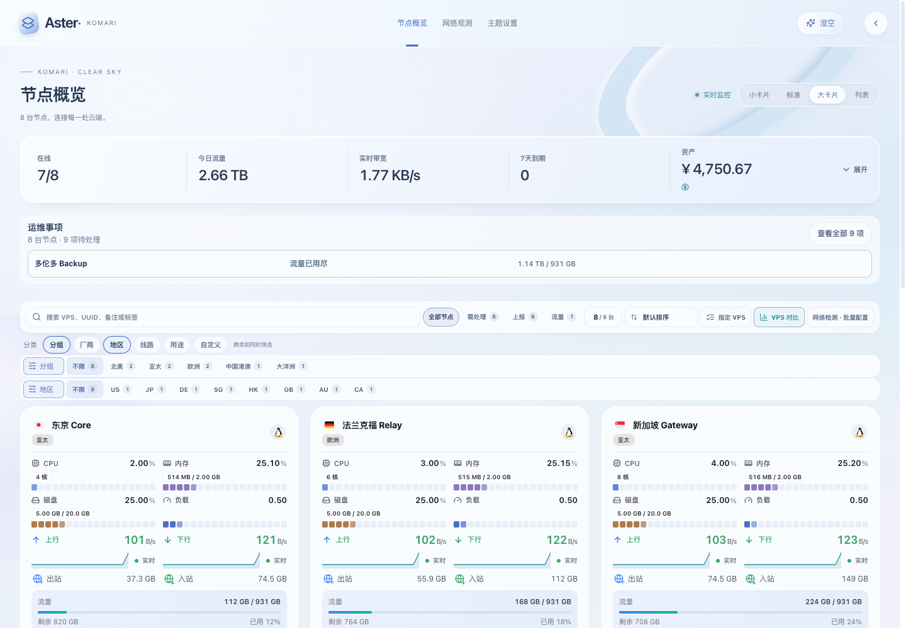
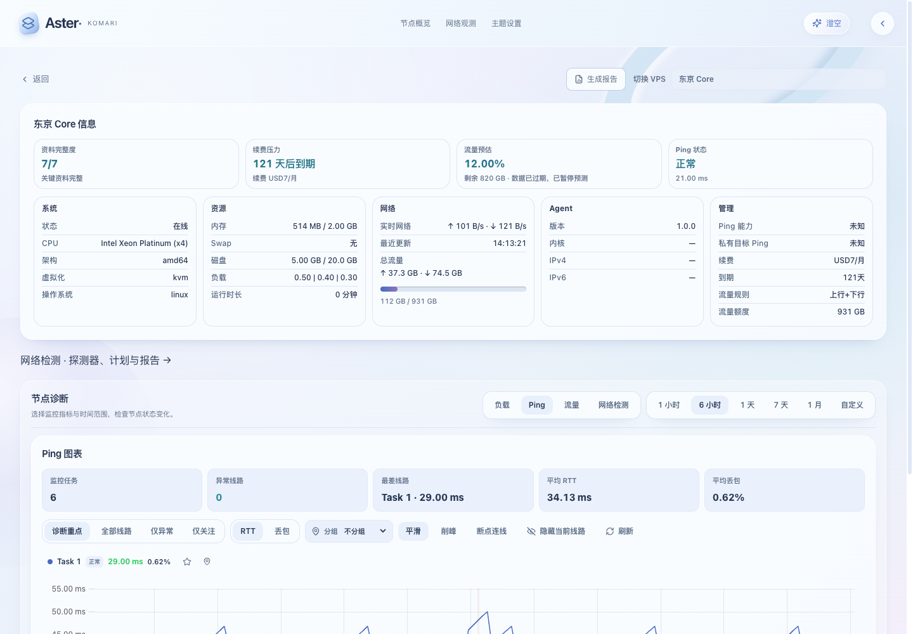

# 澄空外观

Aster 1.10.0 新增「澄空」，采用冷白冰蓝、光感背景、薄片叠层和小幅空间视差。现有监控、筛选、资产、网络检测和实例详情继续使用后端实际数据。

## 启用

1. 安装 Release 中的 `Komari-Theme-Aster-v1.10.0.zip`。
2. 在首页右上角展开快捷按钮，选择星光图标「澄空」。此选择作为个人外观偏好保存，刷新后恢复。
3. 若要将其设为站点默认外观，在 **Aster 工作室 → 外观与布局 → 默认外观** 选择「澄空」并保存。已经手动选择过其他外观的浏览器，仍优先保留自己的偏好。

澄空是独立的明亮外观；原有浅色、深色、跟随系统、诊断均可继续切换。工作室的首页预览使用隔离的草稿，不修改外部页面的偏好或缓存。

## 卡片与流量

首页标题右侧可以直接切换小卡片、标准、大卡片或列表。小卡片的流量区域显示已用 / 总额度、剩余流量、使用比例及进度条。大卡片使用同一份流量模型。

- 配额按节点配置的仅上行、仅下行、求和、取大或取小计费，沿用 Komari 的计算方式。
- 未配置额度时显示 `∞` 和「流量未设限」，不将不限量伪装为已用 0%。
- 超额时保留实际百分比，例如 125%；进度条最高填满 100%，剩余额度最低为 0。
- 这是当前套餐累计流量，今日 / 本月等周期统计仍由首页原有流量排行提供。

## 详情与动效

实例信息、负载和 Ping 图表采用统一的澄空配色。负载图表根据实际容器宽度调整尺寸，给坐标刻度保留空间，避免在较窄卡片内裁切。

桌面鼠标悬停时，卡片有不超过 2° 的倾斜和轻微抬升；背景仅有小幅视差。触屏和系统「减少动态效果」会禁用这些动效。动效采用单个委托监听及按需绘制，不增加节点 API 请求或定时轮询。视觉样式、页头、配额内容和鼠标动效按需加载。

## 发布验证

- `npm run test:release-gates`：396 项单元测试、网络插件 / runner 测试、TypeScript、ESLint、RPC 契约、性能 / 资源预算、主题静态资源路由与浏览器回归。
- `npm run test:plugin-runtime`：官方 Komari 1.4.3、1.5.1 插件运行时。
- 浏览器覆盖官方与 fork 两种模拟后端；澄空专项覆盖四种视图、限量 / 不限量 / 超额、偏好和默认外观恢复、工作室保存 / 隔离预览、负载 / Ping、320–1440px 布局、手机快捷按钮、鼠标交互与减少动态效果。

上述截图均来自实际编译后的主题及兼容模拟后端，演示节点与指标为模拟数据。
