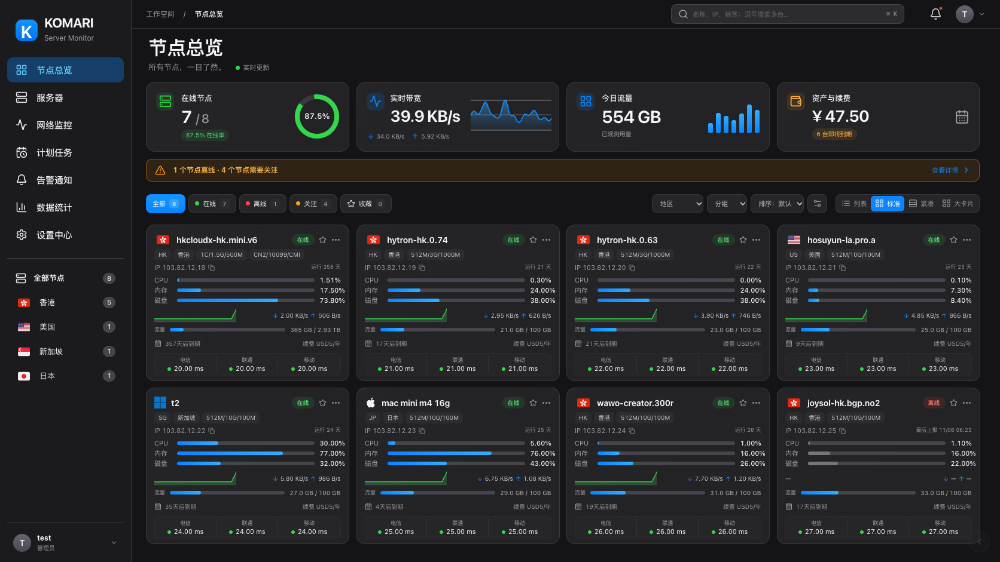
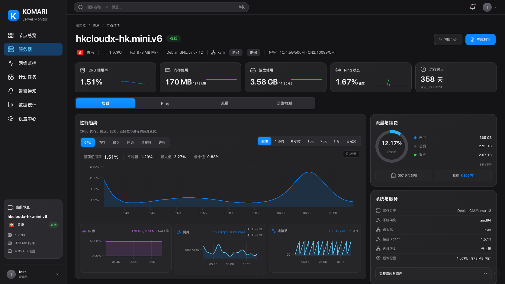
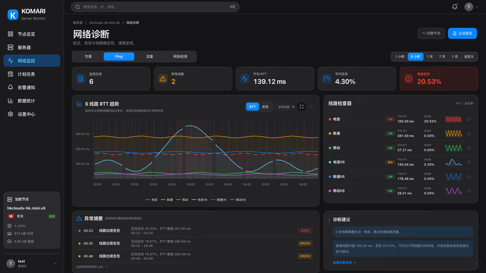

# 原生 · 暗色

1.36.0 新增 Cupertino 的独立暗色版本，依据已确认的三张暗色设计稿实现。画布使用 `#141416`，卡片使用 `#232326`，侧栏使用半透明石墨灰；灰白文字、细边框、连续圆角和系统蓝分段控件构成统一层次。界面由实际组件绘制，图表读取监控历史，不以效果图覆盖页面。

在浮动控件的外观菜单选择 **原生 · 暗色**。管理员也可在 **设置中心 → 外观** 中将其设为站点默认主题。当前设备保存的外观与卡片视图继续优先；亮色 **原生 · Cupertino** 保持独立可选。

## 节点总览

四列标准卡片展示身份、标签、地址、CPU / 内存 / 磁盘、实时网速、流量进度、续费与到期、全部绑定的 Ping 线路。列表、紧凑、大卡片与完整指标展开仍可使用；三网线路、测速和多条件模糊搜索保留。离线节点标注最后上报时间，避免将缓存误认为实时数据。

## VPS 详情

五项指标与常驻的负载 / Ping / 流量 / 网络检测切换栏保持对齐。CPU 主图、三项辅助图、流量续费及系统信息延续设计稿结构；统计文字位于主图上方，不覆盖曲线。内存使用紫色，TCP / UDP 使用独立蓝青色；圆环底轨、macOS 图标、搜索弹层与焦点提示均适配暗色。

## 网络诊断

五项摘要、六线路趋势、线路检查器、异常摘要与诊断建议组成双栏工作台。红 / 橙 / 绿 / 青 / 蓝 / 紫贯穿图线、检查器和图例；RTT / 丢包切换、线路显隐、关注、时间范围及高级设置保持可用。异常文字来自采样，缺失不补为正常。

## 验证

截图尺寸为 **1672 × 941**，来自代码在官方 Komari 兼容模拟环境中的实际浏览器渲染，包含 8 台演示节点和 6 条诊断线路。实际名称、数值、采样曲线和异常数量随服务端数据变化。

浏览器回归覆盖亮暗原生主题的四种首页视图、多条件搜索、收藏、摘要与完整卡片、六项性能图、采样设置、四个详情页签、节点搜索、离线报告入口、三网线路 / 测速、站点默认外观保存，以及 320–1920px 布局。保留同一文档内亮暗切换及两种光域未来样式加载顺序，检查统计文字、异常列和搜索边界，避免页面刷新掩盖样式残留。

主题包为 **1.36.0**。插件 **1.22.5** 仅同步安装包发布指针；已有插件与探测器接口继续兼容，探测器仍为 **1.14.0**，无需重装。
