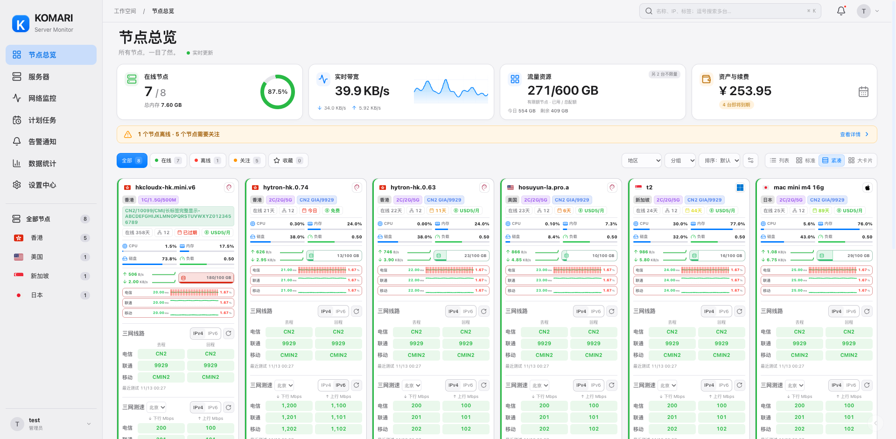
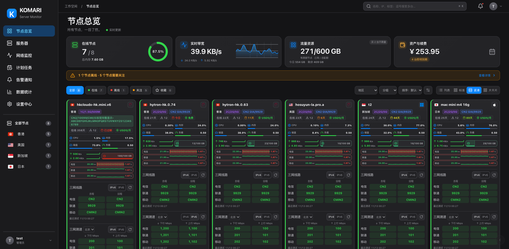
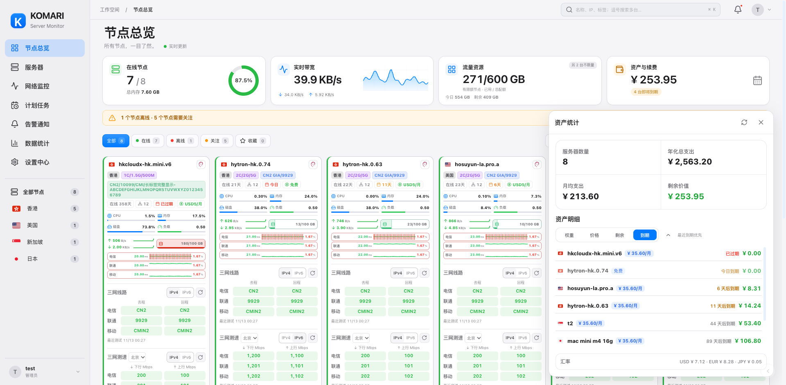
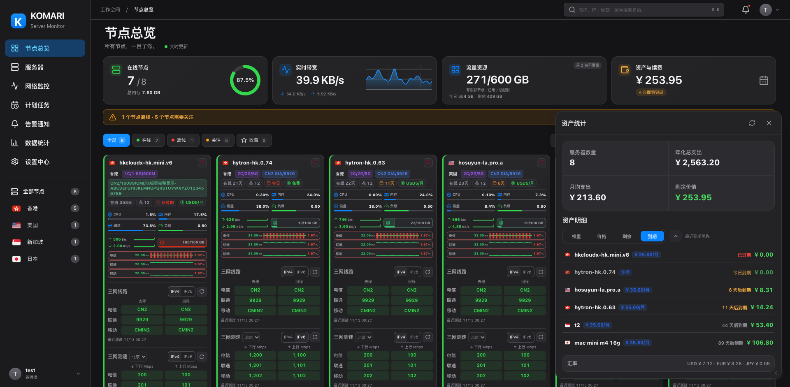
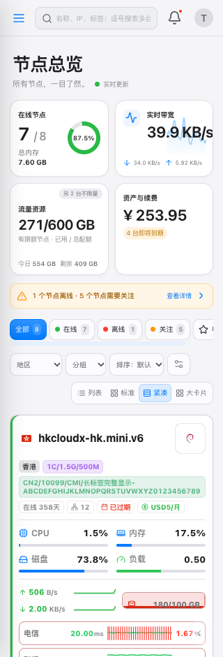
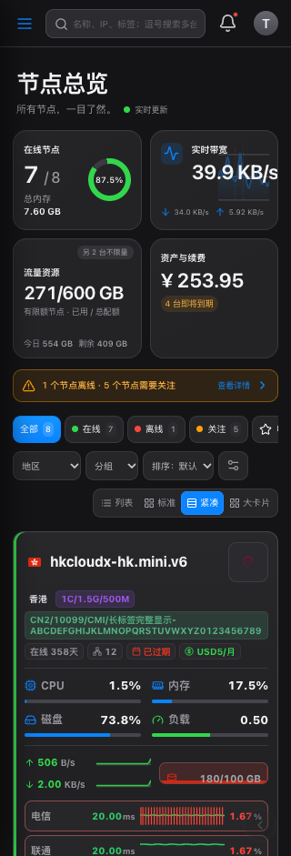

# 原生亮暗主题：资源概览与资产排序

主题 **1.37.0** 同时更新「原生 · Cupertino」与「原生 · 暗色」。桌面首页仍为四张概览卡片，窄屏按两列排列。

- 在线节点卡片增加总内存：统计当前有权查看的全部节点，包含离线节点，不受搜索、地区、分组等筛选影响；缺少内存信息时显示近似标识或占位符。
- 流量资源卡片显示已用 / 总配额，以及今日观测用量和剩余配额。先按每台节点的上行、下行、相加、取大或取小规则计算，再进行汇总。
- 有限额与不限量节点分开统计；不限量节点单独标注数量，悬停可查看其已用量。剩余配额是各节点剩余量之和，超额节点不会消耗其他节点的剩余额度。
- 未收到上报的节点不以初始化零值表示真实用量；部分上报时显示近似标识，并在说明中给出缺失数量。离线节点已有的上报仍参与统计。
- 资产明细增加「到期」排序与正倒序切换。按真实时间排列，免费或未计入资产的节点也按到期时间参与排序；永久、长期、未知日期始终置后。原有权重、价格、剩余价值排序继续可用。
- 紧凑卡片的标签与状态、连接、续费信息分行展示；长标签在卡片宽度内自动换行，卡片随内容增高。

## 实际运行截图

以下为官方 Komari 兼容模拟环境的真实浏览器截图，数值与节点为演示数据。

  
  

网络观测插件 **1.22.6** 仅同步发布指针；已有插件接口保持兼容，探测器仍为 **1.14.0**。
