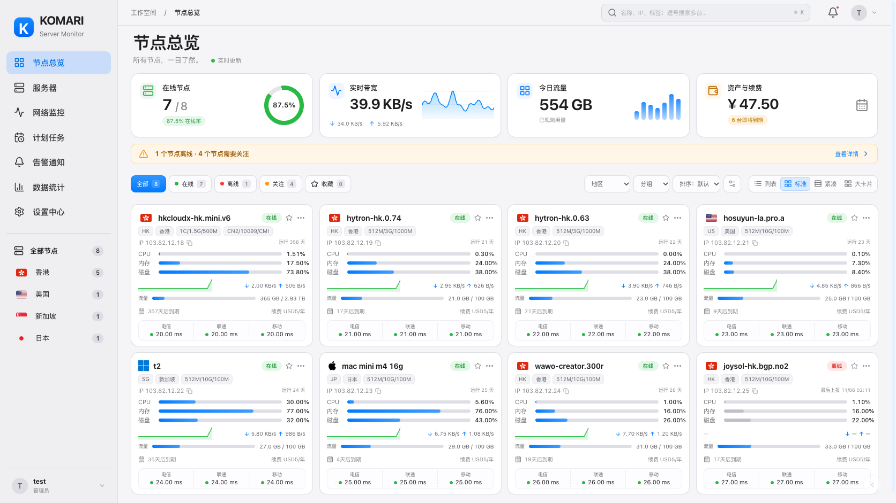
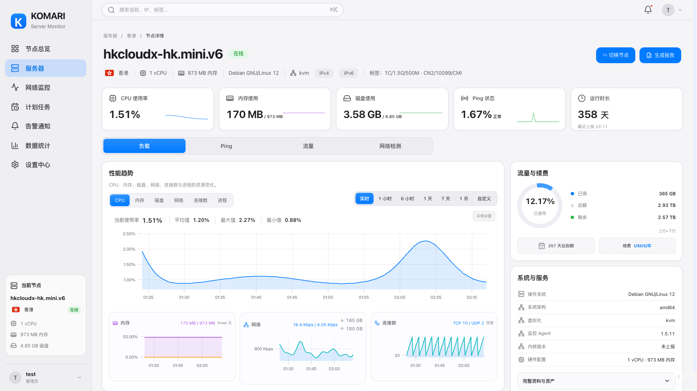
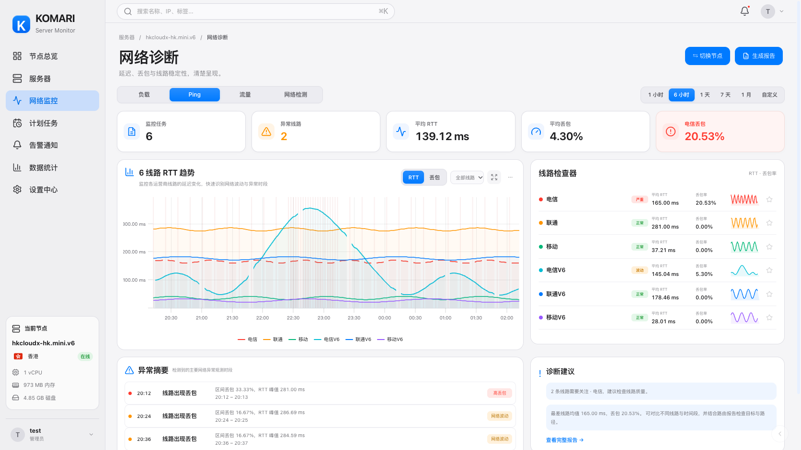
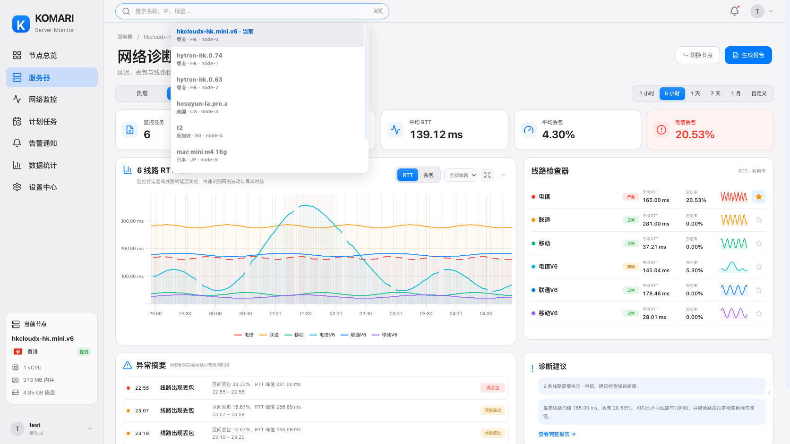

# 原生 · Cupertino

1.35.0 新增的独立浅色主题。以已确认的三张苹果风格设计图为依据，使用珍珠白背景、白色连续圆角卡片、石墨文字、系统蓝选中状态及轻量半透明侧栏。界面由真实组件绘制，不以整张效果图覆盖页面。

在浮动控件的外观菜单选择 **原生 · Cupertino**；管理员也可在 **设置中心 → 外观** 中设为站点默认主题。设备已保存的主题和卡片视图优先。

1.37.0 的总内存与流量资源概览、资产到期排序和紧凑标签换行，见[原生资源概览说明与实际截图](cupertino-resources.md)。同样适用于原生暗色主题。

## 首页

四列标准卡片展示节点身份、标签、地址、资源、实时网速、流量进度、续费与到期，以及已绑定的全部 Ping 线路。任务较多或标签较长时，卡片自然增高。省略号展开原有完整指标；列表、紧凑和大卡片仍可随时切换，三网线路和测速组件按原设置显示。

顶部搜索支持逗号、换行添加多个模糊条件，任一条件匹配即可显示；条件内空格要求同时满足。保留分组、地区、收藏、风险、排序及更多工具。带宽只汇总在线节点，图表使用实际可读取历史。

## 节点详情

运行时长与 CPU、内存、磁盘、Ping 对齐为五项指标。顶部搜索负责选择节点；「切换节点」聚焦同一搜索框。负载 / Ping / 流量 / 网络检测切换栏独立于图表内容。

性能区可选择六项指标，主图与辅助图分层展示；采样覆盖、断点连线和刷新位于「采样设置」。流量、续费和精简系统信息位于右侧；「完整资料与资产」保留原有资料、计费和决策信息。

## 网络诊断

五项摘要与主趋势图、线路检查器、异常观测和诊断建议组合展示。线路显隐、关注、RTT / 丢包、范围和高级设置保留；异常文字由真实采样生成，不将缺失数据补为恢复事件或虚构环比。

## 验证范围

以上截图来自当前代码在官方 Komari 兼容模拟环境中运行，尺寸为 **1672 × 941**，使用 8 台演示节点和 6 条诊断线路；节点名称、计费与监控数值为测试数据。与设计稿不同的数值、曲线和任务数量随真实服务端数据变化。

浏览器回归检查首页四种视图、多条件搜索、收藏、摘要面板、完整卡片、六项性能图表、采样设置、四个详情页签、节点搜索、离线报告入口、三网组件、工作室默认主题保存，以及 320–1920px 的页面宽度。离线节点资源、用量和运行时长明确标为最后上报缓存；原有报告导出逻辑保留。

插件 1.22.3 仅更新安装包发布指针，已有 1.22.0 及以上原始图片接口继续兼容；探测器仍为 1.14.0，无需重装。

## 1.35.1 样式修复

光域未来样式表在单页应用切换外观后仍会保留。为这些主题专属规则增加零权重的主题条件，保持光域未来原有级联顺序，同时隔离共享组件上的定位和排版。Cupertino 的当前值、平均值、最大值和最小值在主图上方横排，窄屏按完整项目换行；Ping 异常时间、标题、观测说明与状态分别占列。节点搜索只由圆角外框显示柔和的焦点提示，内部输入框保持透明并适配容器高度。

新增回归场景先在同一文档内切换外观，分别覆盖两种样式加载顺序；在 320、390、1024、1280、1672、1920px 检查统计标签、摘要文本与聚焦搜索框的实际边界，避免刷新页面清除样式后掩盖问题。

