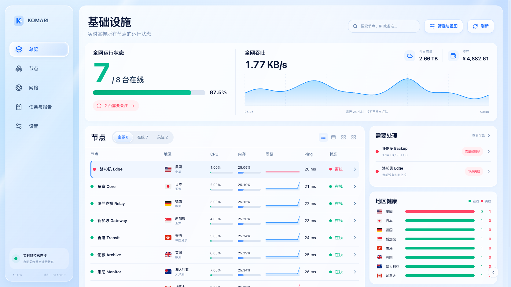
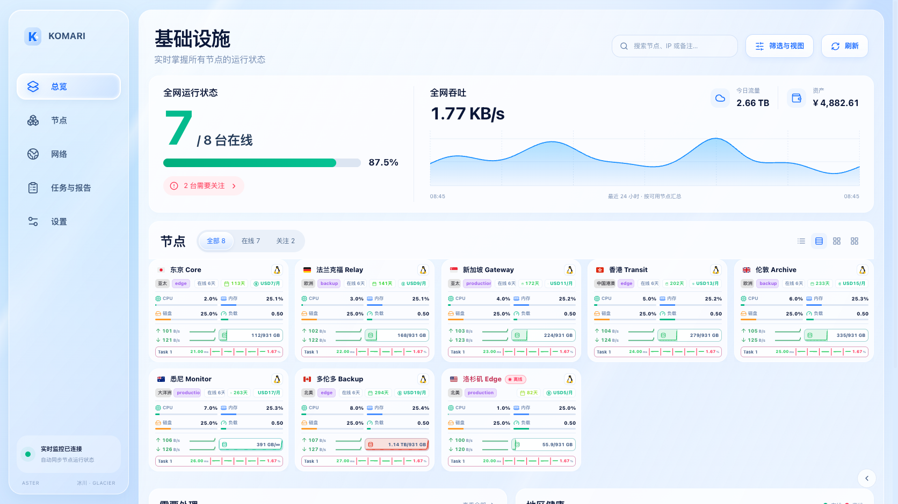
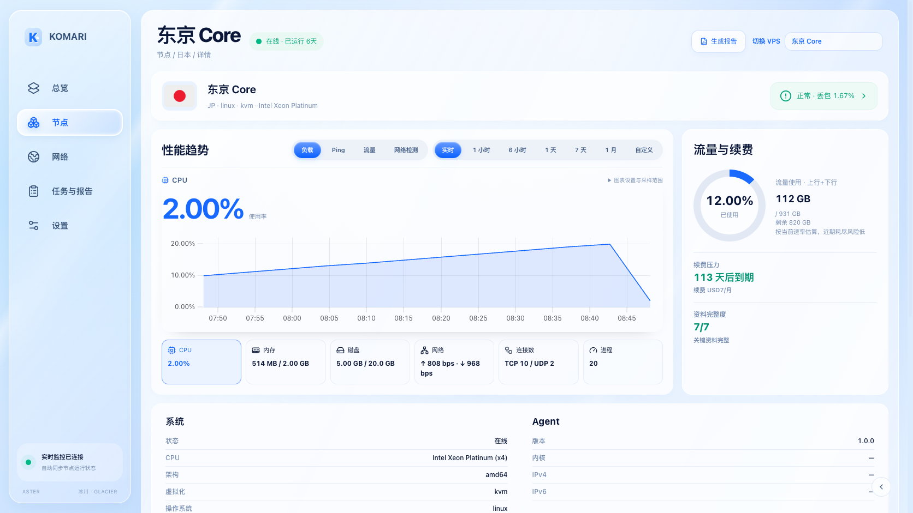
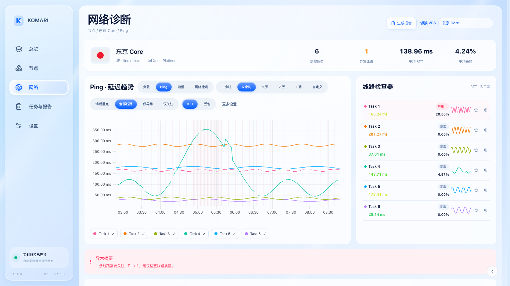
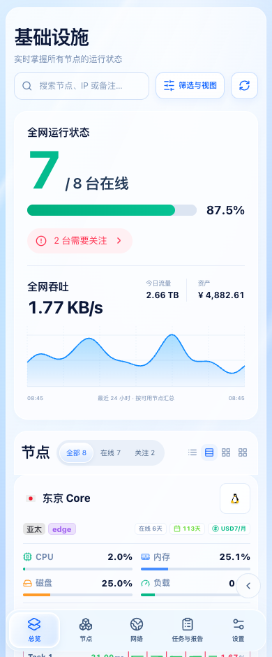

# 冰川 · Glacier

Aster 1.27.0 新增的独立外观，依据三张高保真参考图实现基础设施首页、节点性能详情和 Ping 网络诊断。冰蓝玻璃侧栏、白色内容面板、蓝色分段操作和绿色在线状态贯穿工作区。

## 开启

在右下角展开快捷按钮并选择「冰川」，或在「Aster 工作室 → 外观」将冰川保存为默认外观。原有浅色、深色、曜石、澄空等外观继续可选。

临时切入冰川时，桌面默认列表、手机默认紧凑卡片；当前会话已选择的视图继续保留。将冰川保存为默认外观后，遵循工作室配置的桌面与手机默认布局。

## 首页

- 在线节点数、在线率、需关注节点、实时吞吐、今日流量和剩余资产使用已有数据模型。今日流量覆盖说明和资产明细可直接点击查看。
- 吞吐趋势使用最近 24 小时的批量网络历史，按 15 分钟时间段汇总可用节点；悬停提示时间、速率和覆盖节点数。缺测时间段保留断点，不生成演示曲线。
- 「全部 / 在线 / 关注」与搜索、分类、排序、指定节点等筛选可以组合使用。「筛选与视图」展开原有完整工具；表头支持排序，按住 Shift 可追加排序条件。
- 支持列表、紧凑卡片、标准卡片和大卡片。所有卡片直接复用原组件，资源、磁盘、负载、流量与每日趋势、在线时长、续费、Ping、三网线路和三网测速均按原有配置和数据权限展示。列表右端箭头可展开该节点的完整大卡片。
- 需要处理区使用现有风险证据，并链接到相应节点指标；地区健康区分别统计在线、离线和待上报，后者不会算作离线。





## 节点与网络诊断

节点页提供 CPU、内存（含 Swap）、磁盘、网络、连接数和进程六项切换。流量使用环遵守节点的流量计费规则，保留不限量和超额情况；续费和资料完整度位于右侧，系统、资源、网络、Agent 和管理明细继续完整展示。点击「图表设置与采样范围」可查看覆盖和采样、刷新或调整断点连线。



Ping 页面同时展示线路数、异常数、平均 RTT、平均丢包、延迟/丢包主图和线路检查器。检查器提供均值、丢包、严重程度、真实历史小趋势、关注与定位；图例可切换线路。分组、平滑、削峰、断点连线、刷新等控制在「更多设置」展开。报告、时间范围和完整网络检测入口继续可用。



手机改用底部导航，列表在自身区域横向滚动；卡片与诊断面板纵向排列。工作室配置的背景图与表面不透明度继续生效。



## 验证

截图由构建产物在官方 Komari RPC 模拟环境中运行生成，节点与数值为测试数据。已对照参考图检查首页、详情与 Ping 的导航、布局、面板、曲线与选中状态，并检查 1672、1024、390 和 320 CSS 像素下四种视图、详情与图表容器的宽度。

运行 `npm run test:release-gates` 进行完整发布回归。单独检查冰川：

```sh
npm run build
BROWSER_GLACIER_ONLY=1 BROWSER_GLACIER_SCREENSHOT_BASE=/tmp/glacier node scripts/browser-scale-gates.mjs
```

浏览器验证覆盖主题持久化、工作室保存与隔离预览、完整卡片展开、搜索与在线筛选、六项性能指标、Ping 摘要和图表、窄屏无页面横向溢出，以及切回原有明暗外观。冰川的主体组件和样式按需加载。

1.27.1 同步原有资产计算状态：初次读取显示“计算中”，汇率读取失败且没有缓存时显示“—”，不会一直停留在加载提示。

本次只更新主题；网络观测插件仍为 1.20.0，探测器仍为 1.14.0。
