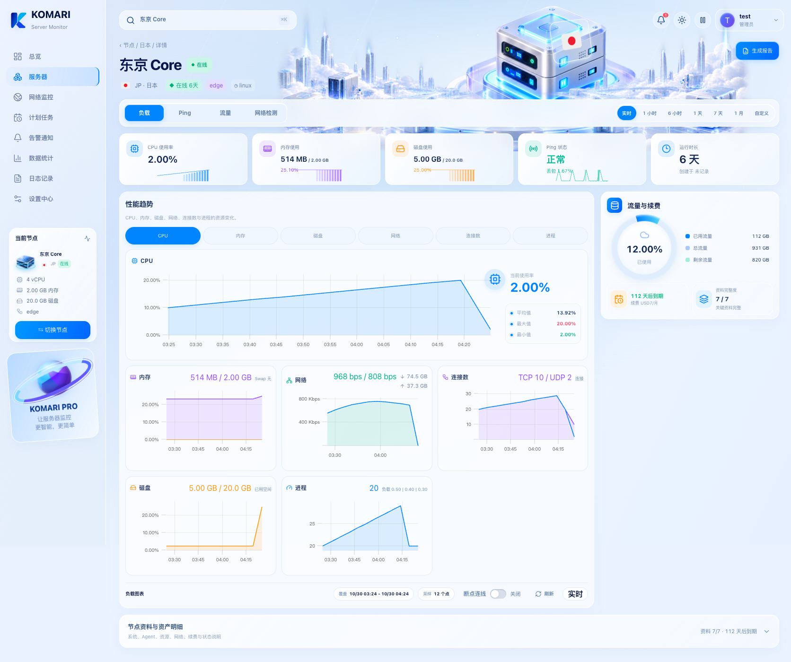
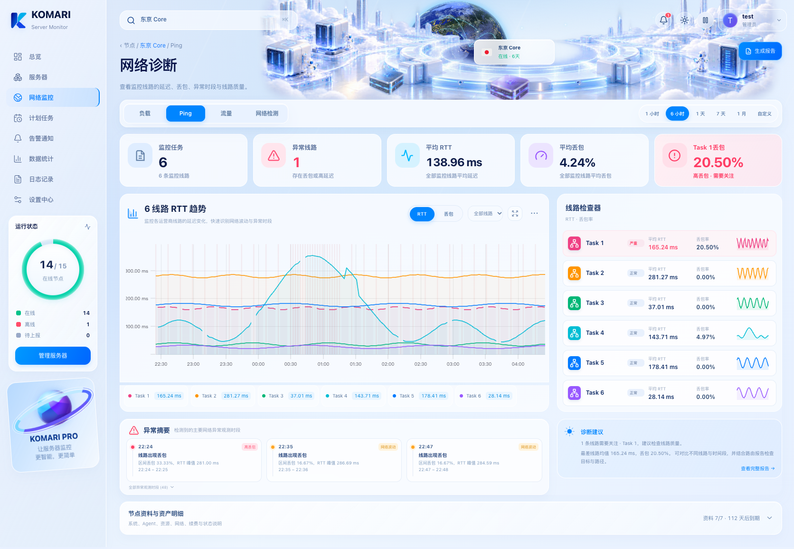
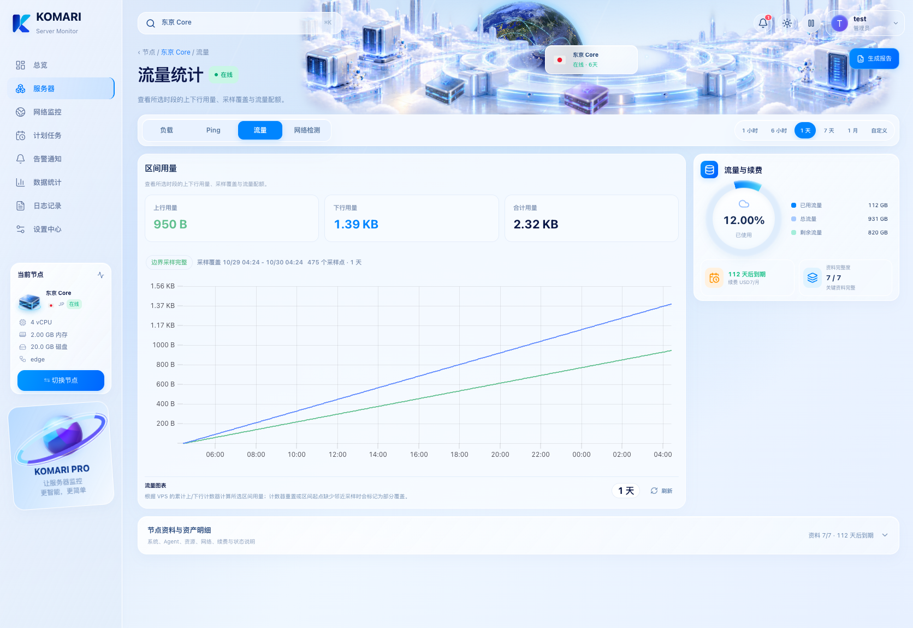
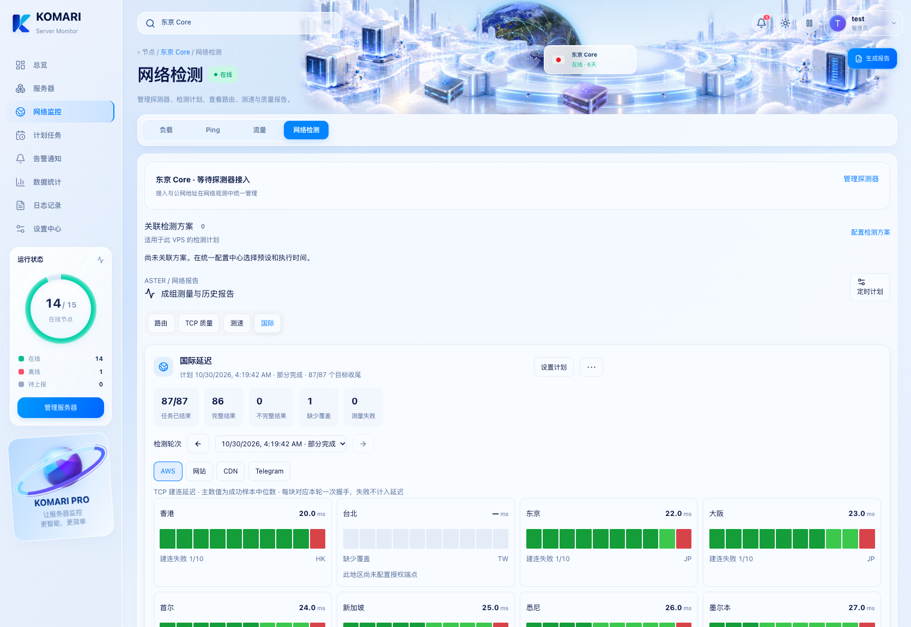

# 光域未来实例工作区 · 1.30.1

修复切换到 Ping 后主导航消失、固定网格行保留空白以及资产卡片漂移。四个工作区改用各自的内容结构，页签与适用的时间范围始终在同一导航区，支持真实鼠标点击、方向键、浏览器前进 / 返回、刷新和换 VPS 后保留当前工作区。

| 页签 | 主内容 | 辅助信息 |
| --- | --- | --- |
| 负载 | CPU、内存、磁盘、Ping 状态、运行时长五项指标；六项资源历史图 | 配额、续费和资料完整度侧栏 |
| Ping | 线路数量、异常、RTT、丢包摘要；趋势、线路检查器、异常观测与建议 | 历史保留提示、自定义范围、关注、分组及图表设置 |
| 流量 | 所选范围的上下行用量、采样覆盖、用量趋势 | 累计配额、剩余流量、续费与资料完整度 |
| 网络检测 | 已有探测器、关联计划、路由、测速、质量检测和报告功能 | 插件不可用时给出原有连接 / 安装状态 |

顶部搜索复用原有 VPS 选择器，支持名称、UUID、IP、地区、分组、标签等字段与键盘操作，移除右上角重复入口。运行时长不再绝对定位在插画右侧，进入统一指标行。

资料完整度、续费压力、流量预估和 Ping 状态不是删除，而是和五组原始节点信息一起收进「节点资料与资产明细」。默认收起，紧跟当前内容区域；关键配额、续费和线路异常在对应工作区直接呈现。到期深链接会展开明细。离线节点保留缓存数据说明。侧栏装饰参与正常排版，避免覆盖当前节点。

## 构建产物截图

均来自官方 Komari RPC 测试环境，数据为测试数据；负载、Ping、流量为全页截图，用于确认无额外保留的空白行；网络检测为首屏，长报告可继续向下滚动。









## 验证

专项浏览器检查在 1920、1672、1024、390、320px 下反复真实点击四个页签，确认页签可命中、URL 与内容一致、五项指标同组、搜索入口唯一、非相关资产面板不出现，且节点资料紧跟当前内容。负载图表验证实际画布曲线，覆盖首次历史到达和从其他工作区切回的情形。另验证完整明细字段、换 VPS 保留页签、浏览器历史 / 刷新、7 天历史保留提示与自定义时间范围；覆盖范围还包含原有四种首页视图及旧主题。

```sh
npm run test:release-gates
CI=true BROWSER_LUMINOUS_ONLY=1 BROWSER_LUMINOUS_SCREENSHOT_BASE=/tmp/luminous-instance-fix node scripts/browser-scale-gates.mjs
```

本次只更新主题，网络观测插件仍为 1.20.0，探测器仍为 1.14.0。
