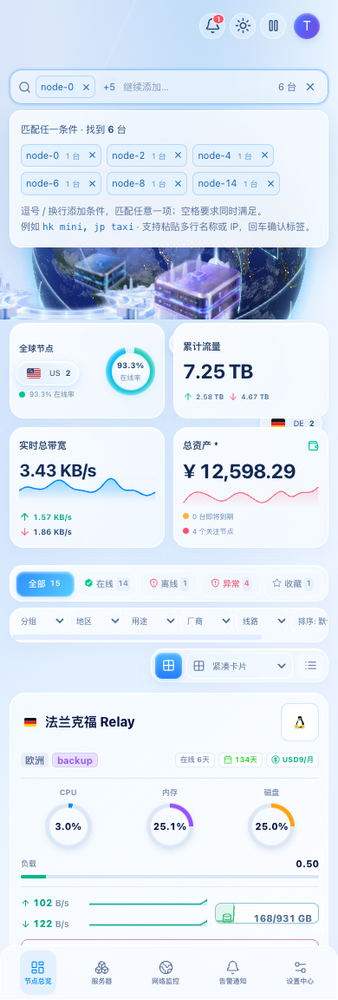

# 光域未来 · 多台 VPS 搜索

v1.31.0 在首页顶部加入多条件搜索。每个标签代表一项文字条件，可匹配一台或多台 VPS；结果随实时节点和条件更新。

## 输入规则

| 输入 | 结果 |
| --- | --- |
| `hytron` | 名称或其他搜索字段包含 hytron 的 VPS |
| `hk mini` | 同一台 VPS 的搜索字段同时包含 hk 与 mini |
| `hytron, joysol` | 包含 hytron 或 joysol，合并结果 |
| `hk mini, jp taxi` | 同时满足 hk + mini，或者 jp + taxi |
| 多行名称、UUID、IPv4 或 IPv6 | 每行作为独立条件，合并结果 |

中文 / 英文逗号和换行均可分隔条件；空格保留在组内，适用于 `mac mini m4 16g` 等名称。匹配不区分大小写，统一全半角，忽略多余空白，并自动去除重复条件。同一台 VPS 命中多组也只显示一次。

搜索字段包括名称、UUID、IP、地区、分组、厂商、用途、标签、备注、操作系统 / Agent 版本及配置的分类字段，以服务端提供且当前可见的数据为准。使用包含匹配，不自动纠正名称、IP 或 UUID 的拼写。

## 操作与布局

- 输入时即时过滤卡片或列表；逗号确认前一组，回车确认当前组，随后可以继续输入。
- 可以直接粘贴多行名称 / IP；文本插入在当前光标或选区处，不丢失已有条件。首尾空行和重复项会被忽略。
- 点击标签文字修改，点击叉号删除；修改时选中原文字，输入即可替换。删除单项会保留未确认的输入。
- 输入框为空时，第一次退格选中最后一项，第二次删除；Escape 收起搜索说明。中文输入法选词回车不会提前确认标签。
- 搜索栏显示实时匹配数量。桌面展示最多两个标签，窄屏展示一个，其余折叠为 `+N`；展开后可查看、编辑和删除所有条件。搜索栏保持一行，不挤压场景布局。
- `⌘K` / `Ctrl+K` 和筛选栏的搜索按钮均可聚焦输入。

地区、分组、在线 / 离线 / 异常 / 收藏及高级筛选继续与搜索取交集。没有任何节点匹配的条件用浅橙色标记；存在匹配但被筛选隐藏时显示“另有 N 台被筛选隐藏”，不会把该条件标记为拼写错误。标签旁的数量表示其他筛选之前的匹配数，搜索栏数量表示当前实际结果数。

本次多条件交互用于光域未来首页；实例页顶部仍用于搜索并切换到单台 VPS。

## 浏览器验证

验证覆盖组间“或”、组内“且”、全半角 / 大小写去重、多行粘贴与选区替换、IPv4 / IPv6、标签编辑与两次退格、输入法确认、筛选隐藏提示、四种视图和 320 / 390 / 1024 / 1920px 布局。按钮使用真实鼠标命中检查，文字输入和键盘使用浏览器输入事件。

截图来自构建产物和模拟官方 Komari RPC 的测试节点；节点和数值为测试数据。




完整检查：`npm run test:release-gates`。专项及截图：

```sh
npm run build
CI=true BROWSER_LUMINOUS_ONLY=1 BROWSER_LUMINOUS_SCREENSHOT_BASE=/tmp/luminous-search node scripts/browser-scale-gates.mjs
```
