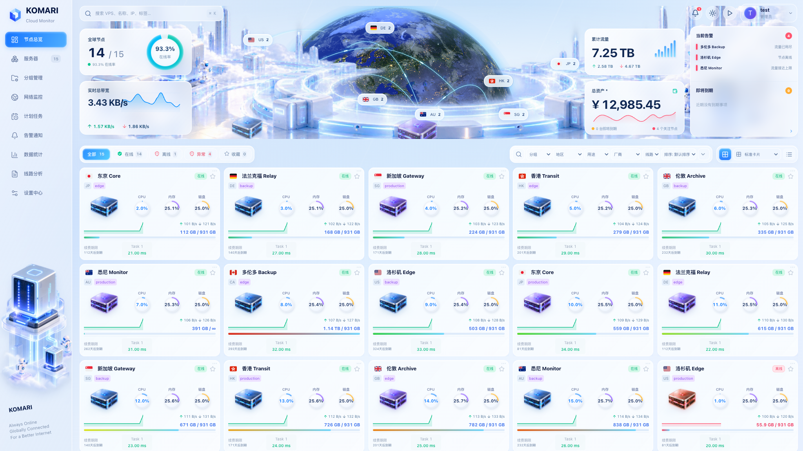
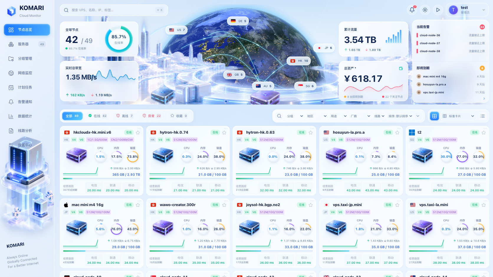
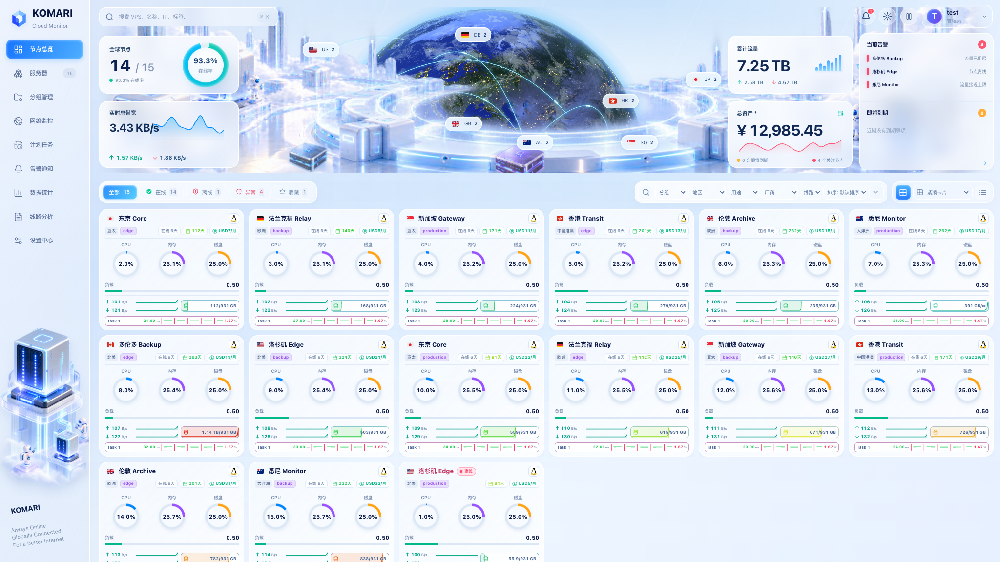
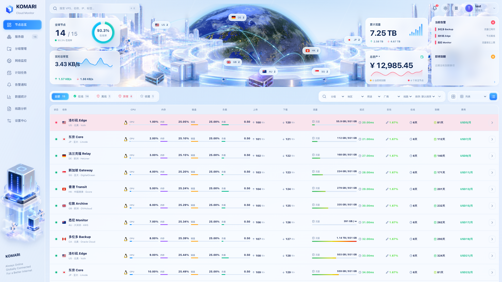
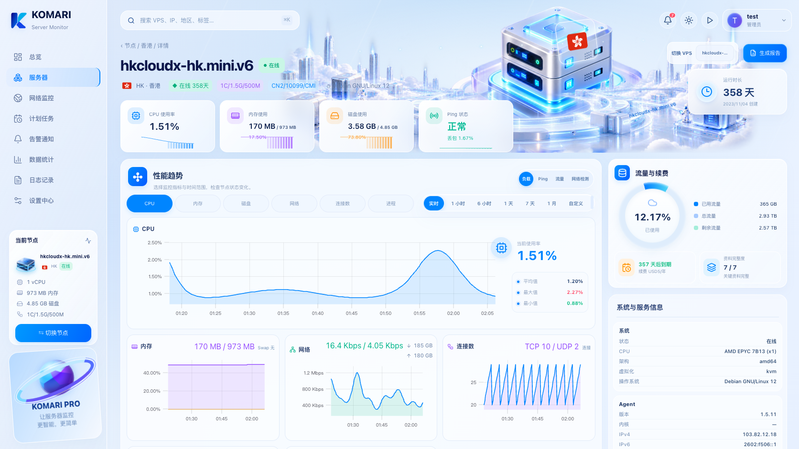
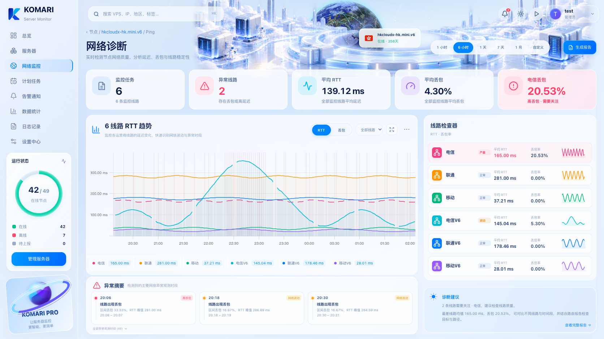
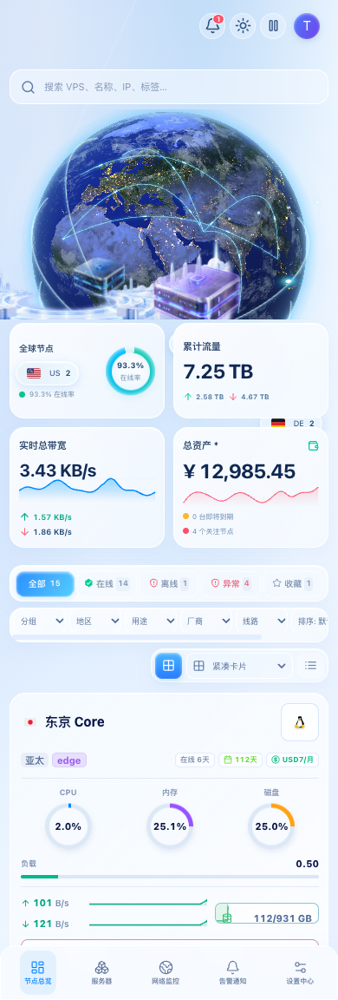

# 光域未来 · Luminous Future

Aster 1.29.0 新增、1.30.0 按参考画面重新校准的独立浅色主题，依据三张高保真参考图实现蓝白玻璃总览、实例性能与网络诊断。参考图中的空间装置在运行中使用实时三维地球、透视轨道和分层服务器呈现，截图仅记录其中一帧。

## 启用

在账户菜单的「主题与视图设置」中选择「光域未来」，或在 Aster 工作室「外观与布局」中保存为默认外观。初次临时切入时，桌面使用标准卡片、手机使用紧凑卡片；会话中明确选择的视图优先，保存默认主题后遵循工作室的桌面与手机布局。

1.29.1 将总览明细面板改为点击时按需加载，减少所有主题的首页初始包，保留现有交互和数据。

安装包为 `Komari-Theme-Aster-v1.30.0.zip`，通过 Komari 后台上传并启用。浅色、深色、冰川、星轨、澄空和曜石等外观继续可选。

## 动态场景

- 地球使用原生 WebGL 球面渲染，带有真实日间地表、夜间城市灯光、云层、光照、大气边缘及装饰光点，缓慢自转。
- 多条透视轨道围绕地球，光点持续运行；服务器使用依参考图重绘的立体材质插画，以透视变换整体浮动；图形与场景独立于界面文字。
- 首页、实例与网络诊断场景各自匹配地球或服务器主题；鼠标经过时产生轻微空间视差。城市云台、流动光线、漂浮粒子与装饰柱条保持柔和节奏。
- 资源仪表使用透视环，实际指标变化时平滑过渡。数据文字和操作控件保持稳定。
- 右上角播放 / 暂停按钮可暂停并保存个人偏好。系统开启「减少动态效果」时停止动画与视差；隐藏标签页、离开视口的地球和屏幕外服务器不会继续运行动画。
- 地球限制帧率与像素比，没有引入三维运行库。WebGL 不可用、贴图读取失败或上下文丢失时保留静态地球与全部监控操作。

地球、光轨、装置和城市是装饰性场景；不表示实测路径或物理机房位置。地区标签与数量按实际节点汇总。贴图与生成素材的来源、提示词摘要及授权见 [素材记录](luminous-assets.md)。

## 首页与四种视图

首页展示在线率、真实网络吞吐与 24 小时趋势、累计流量、剩余资产估值、关注事项和到期入口。资产读取失败时显示空值。总览可按工作室配置关闭。

地区标签可直接筛选，搜索支持名称、IP、备注及原有搜索字段；`⌘K` / `Ctrl+K` 聚焦搜索。地区、分组与全部 / 在线 / 离线 / 异常 / 收藏筛选可组合使用。「更多筛选」保留原有分类、排序、指定节点、保存视图、对比与网络观测工具。

列表、标准、紧凑和大卡片四种视图均保留。标准卡片按参考图恢复五列、236px 高的摘要布局，含三维服务器与资源环，点右上角省略号展开同卡片内的完整原始指标；紧凑卡片含资源环和完整原有内容。CPU、内存、磁盘、容量、负载、上下载速率与历史、流量配额和每日趋势、Ping 任务、三网线路、三网测速、续费、标签与在线时长继续按配置、权限及数据可用性显示。列表保留完整字段与多条件排序，大卡片保留扩展内容。









## 实例与网络诊断

实例页提供浮动服务器场景、四项实时指标、实际历史小柱图、状态及网络 I/O。性能区包含一个选中大图与全部次要图，CPU、内存 / Swap、磁盘、网络、连接数和进程六项指标继续可用；顶部指标按钮切换主图。资料完整度、流量、续费、系统、Agent、网络和能力信息保留。



网络诊断展示监控任务、异常线路、平均 RTT、平均丢包与最差线路丢包。RTT / 丢包、时间范围、缩放、筛选、分组、关注、定位、平滑、削峰与断点连线均可用。线路检查器显示真实统计与历史，异常时间线直接复用主图观测区间；摘要与报告不虚构故障原因、相对涨跌或持续时间。



## 手机与验证

手机以底部导航和纵向面板呈现，图表随容器缩放，列表在自身容器内滚动。



截图来自构建产物与官方 Komari RPC 模拟环境，节点和数值为测试数据。参考检查模式以 49 个节点、42 个在线、参考名称与容量重现数据密度；生产组件不含这些演示数值。插画依据截图重绘，动态帧和真实监控数据会随运行变化。已逐页对照参考图检查玻璃面板、场景层次、配色、仪表、图表与状态，覆盖 2048、1672、1440、1024、390 和 320 CSS 像素。

完整回归：`npm run test:release-gates`。专项检查及截图：

```sh
npm run build
CI=true BROWSER_LUMINOUS_ONLY=1 BROWSER_LUMINOUS_SCREENSHOT_BASE=/tmp/luminous node scripts/browser-scale-gates.mjs
CI=true BROWSER_LUMINOUS_ONLY=1 BROWSER_LUMINOUS_REFERENCE=1 BROWSER_LUMINOUS_SCREENSHOT_BASE=/tmp/luminous-reference node scripts/browser-scale-gates.mjs
```

专项覆盖地球实际帧像素变化、三维变换、暂停、减少动态效果、WebGL 降级、四种视图、键盘搜索、地区筛选、全部六项性能图、Ping 线路与异常时间线、网络卡片完整内容、工作室默认值与隔离预览、旧主题切换及汇率读取失败。

本次仅更新主题。网络观测插件仍为 1.20.0，探测器仍为 1.14.0；已有安装无需重新部署。
