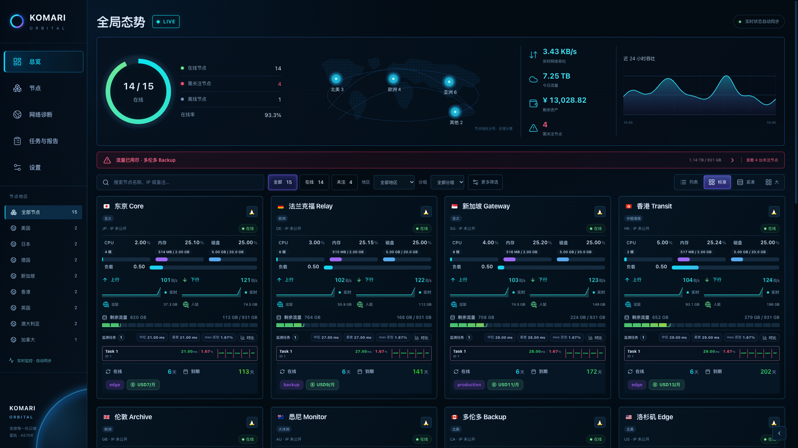
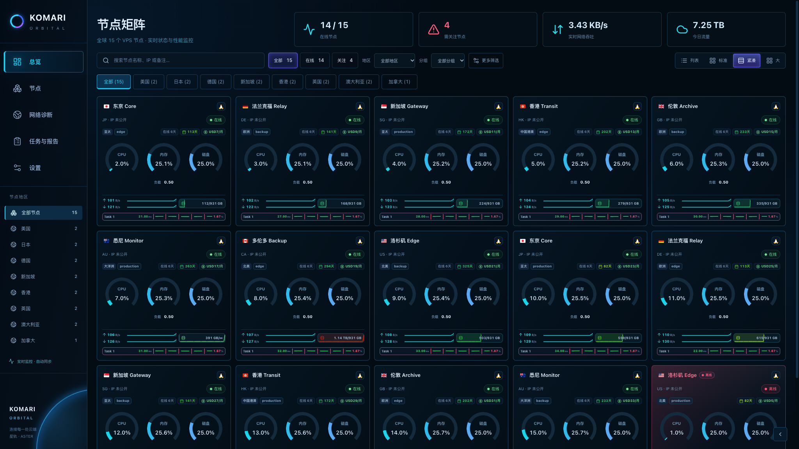
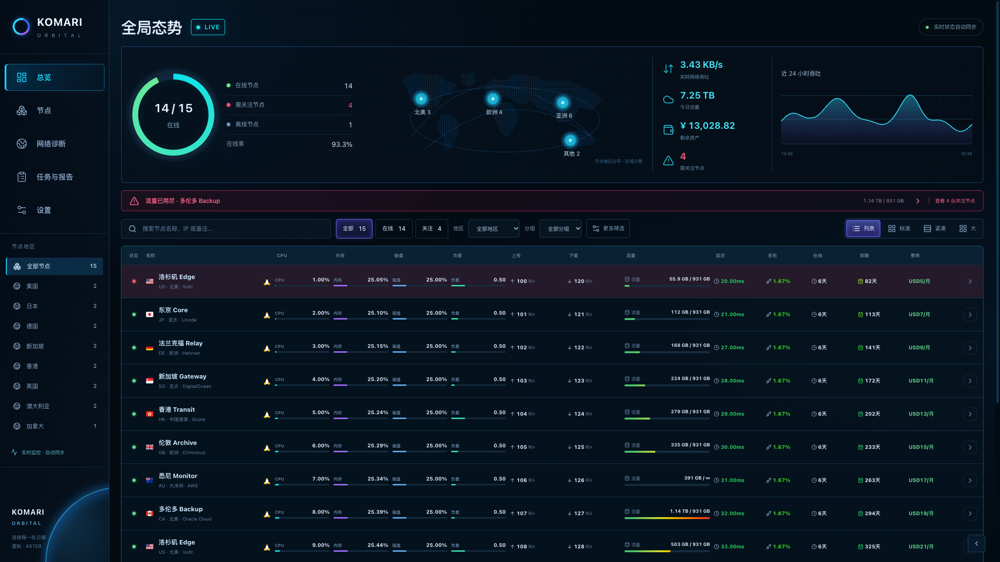
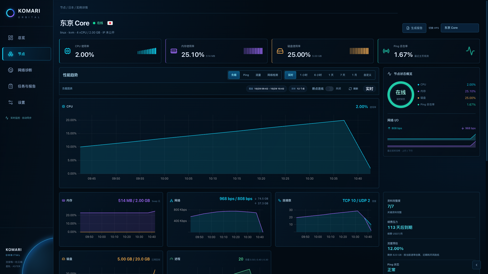
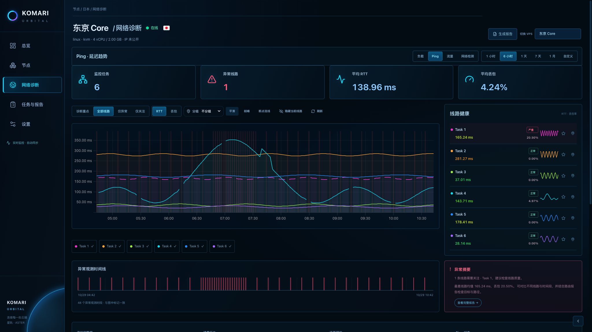
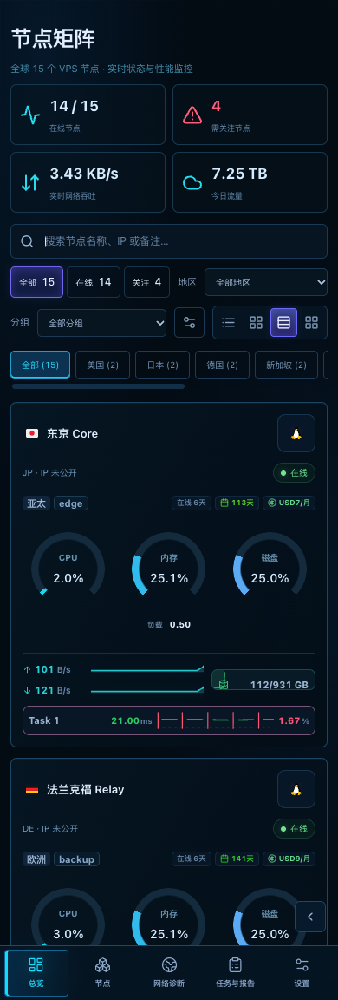

# 星轨 · Orbital

Aster 1.28.0 新增的独立暗色外观，依据四张高保真参考图实现总览、节点矩阵、实例性能与网络诊断。深海蓝底色、青紫强调色、细线面板、环形仪表和地区示意图贯穿工作区。

## 启用与布局

展开页面快捷按钮，选择「星轨」；也可以在 Aster 工作室的「外观」中将它保存为默认外观。浅色、深色、冰川、澄空、曜石等外观继续可选。

初次临时切入星轨时，桌面使用标准卡片，手机使用紧凑卡片；当前会话已明确选择的视图优先保留。保存为默认外观后，遵循工作室配置的桌面和手机布局。

## 首页总览与节点矩阵

- 总览展示在线率、在线 / 离线 / 关注节点数、实时网络吞吐、今日流量、剩余资产和最近 24 小时吞吐历史。
- 地图按节点填写的地区归类，显示真实节点数量。地图和轨道为地区分布示意，不表示节点之间的实测网络连接。
- 关注提示来自现有风险模型，可跳转到节点对应指标；地区、分组、状态和空格分词搜索可组合使用。地区选择与侧栏保持同步。
- 标准、大卡片保留原组件的全部内容，并调整为连续资源进度条、青紫配色和更紧凑的任务区。
- 紧凑视图切换到节点矩阵，以三个环形仪表展示 CPU、内存和磁盘；负载、IP 发布状态、在线时长、续费、流量、每日趋势、Ping、三网线路和测速继续按已有配置与权限展示。
- 列表继续提供原有完整指标与多条件排序。「更多筛选」可展开原有分类、排序、指定节点、保存视图、对比和网络观测入口。







## 实例性能

顶部集中展示 CPU、内存、磁盘与主页 Ping 丢包观测；资源小柱图来自实际历史采样。状态面板使用现有主机状态和风险结果，不生成没有数据依据的综合分数。

性能工作区提供一个大图及全部次要指标图。点击底部性能指标可切换大图，CPU、内存与 Swap、磁盘、网络、连接数、进程均继续可用。系统、资源、Agent、网络、资产和能力配置完整保留；网络 I/O、配额、续费与资料完整度位于右侧，手机上顺序排列。



## 网络诊断

网络诊断展示监控任务、异常线路、平均 RTT 与平均丢包率，主图支持 RTT / 丢包切换、时间范围、缩放、线路筛选、关注、分组、平滑、削峰和断点连线。右侧线路健康区保留均值、丢包率、严重程度、历史小趋势、关注与定位。

异常时间线复用主图的真实异常观测时段，显示实际时间边界。摘要与完整报告入口使用真实统计，不预填参考图中的故障原因、相对涨跌或持续时长。没有记录、历史保留不足、采样缺口和读取失败继续明确显示。



## 手机与验证

手机使用底部导航，仪表卡片和详情面板纵向排列；列表在自身容器内横向滚动。自定义背景、表面透明度和系统减少动态效果的偏好继续有效。



以上截图由构建产物在官方 Komari RPC 模拟环境中运行生成，节点与数值为测试数据。已对照四张参考图检查页面结构、配色、卡片、图表、仪表和选中状态，并验证 2048、1440、1024、390 与 320 CSS 像素下的布局与交互。

完整检查：`npm run test:release-gates`。星轨专项检查与截图：

```sh
npm run build
BROWSER_ORBITAL_ONLY=1 BROWSER_ORBITAL_SCREENSHOT_BASE=/tmp/orbital node scripts/browser-scale-gates.mjs
```

覆盖四种视图、搜索与地区筛选、环形资源仪表、六项性能图、Ping 线路与异常时间线、窄屏图表宽度、工作室保存与隔离预览、主题持久化、旧主题切换和汇率失败时的空值显示。

本次更新主题，网络观测插件仍为 1.20.0，探测器仍为 1.14.0；已有安装无需重新部署。
